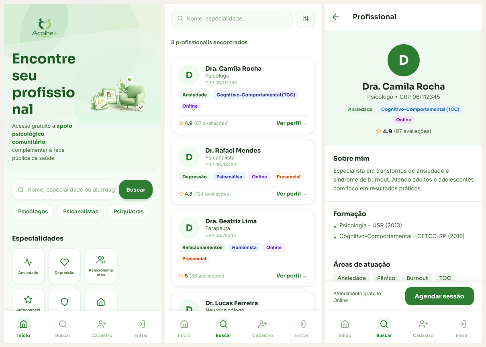

# Acolhe+ Mobile

App de apoio à saúde mental comunitária: o usuário busca profissionais (psicólogos, psicanalistas, psiquiatras e outros) por especialidade, abordagem e modalidade, vê o perfil completo e solicita uma sessão.

Back-end: [acolhe-back](https://github.com/Azaf3/acolhe-back)



## Funcionalidades

- **Busca com filtros** por nome, profissão, especialidade e modalidade (online ou presencial)
- **Perfil do profissional** com formação, áreas de atuação, avaliações e botão para agendar sessão
- **Dois tipos de conta:** paciente e profissional, cada um com cadastro e login próprios
- **Ficha do paciente** e área de perfil
- **Sessão persistente:** o login fica salvo no aparelho com AsyncStorage
- Navegação com abas inferiores e pilhas por seção

## Stack

- React Native 0.81 + Expo SDK 54
- React Navigation (Bottom Tabs + Native Stack)
- AsyncStorage
- Context API para autenticação
- Roda também na web via React Native Web

## Rodando localmente

```bash
npm install
npx expo start
```

Escaneie o QR code com o app **Expo Go** no celular, ou pressione `a` (Android), `i` (iOS) ou `w` (navegador).

## Estrutura

```
src/
├── context/AuthContext.jsx   autenticação e sessão (AsyncStorage)
├── navigation/index.jsx      telas e navegação (abas + pilhas)
├── data/psychologists.js     base de profissionais
└── theme.js                  cores, tipografia e espaçamentos
```
